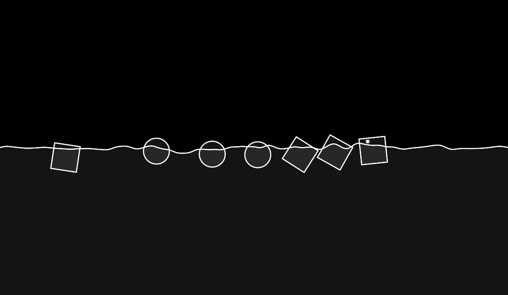
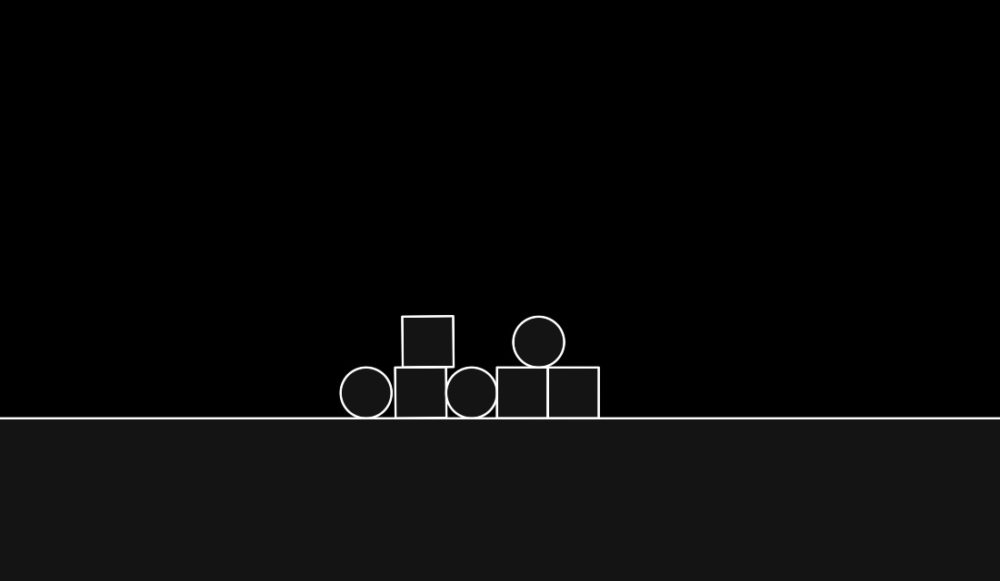

# SlopSandbox

A 2D physics sandbox for macOS: cubes, balls and shapes you draw yourself on
land or in water, with welds, wheels and thrusters.

[Русский](#slopsandbox-1)



## Download

**[SlopSandbox.dmg](https://github.com/Drtonix/SlopSandbox/releases/latest/download/SlopSandbox.dmg)**

First launch goes through right-click → **Open** → **Open**.

## Features

**Two worlds.** Land, or water with waves.

**Bodies.** Ready-made cube, ball and triangle (Q, W, E), or draw your own:
rectangle, circle, triangle or freehand (R, T, Y, U; Shift constrains).

**Tools.** Weld, wheel and thruster (2–4; F toggles the thruster under the
cursor), bounce, slip, sticky and glass materials (5–8). Space freezes time,
G and H change its speed.

**Look.** Light and dark themes, a pixel mode with an adjustable resolution,
and a fine-tuning panel for the water and input physics.

**Languages.** Russian and English.

## Requirements

Apple Silicon, macOS 13 or newer.

## Build

```
git clone --recurse-submodules git@github.com:Drtonix/SlopSandbox.git
cd SlopSandbox
./build_app.sh
```

Needs Xcode, not only the Command Line Tools.

`SlopSandbox --snapshot <folder>` renders the water and land scenes to PNG
frames without a window; `--physics` prints fall, tower, roll and throw
measurements; `--smoke-test` checks Box2D.

Two side builds: `SlopSandboxSDL` (`scripts/build_macos.sh`, needs SDL2 from
Homebrew) and a C++ version on raylib in `CVER/` (`CVER/build_cpp.sh`, CMake).

## Support

[DonationAlerts](https://www.donationalerts.com/r/bdub) · [DALINK](https://dalink.to/bdub) · [CloudTips](https://pay.cloudtips.ru/p/4a29ea73)

USDT TRC-20: `TEzUu8mVuNS1faHGobMWifmvErTuKUSkPD`

## License

MIT, see [LICENSE](LICENSE). Box2D, raylib and SDL keep their own licenses, see
[THIRD-PARTY.md](THIRD-PARTY.md).

DrTonix · [bdub.space](https://bdub.space)

---

# SlopSandbox

Двумерная физическая песочница для macOS: кубы, шары и нарисованные от руки
фигуры на суше или в воде, со сваркой, колёсами и двигателями.

[English](#slopsandbox)



## Скачать

**[SlopSandbox.dmg](https://github.com/Drtonix/SlopSandbox/releases/latest/download/SlopSandbox.dmg)**

Первый запуск — правой кнопкой → **Открыть** → **Открыть**.

## Возможности

**Два мира.** Суша или вода с волнами.

**Тела.** Готовые куб, шар и треугольник (Q, W, E) или свои: прямоугольник,
круг, треугольник или от руки (R, T, Y, U; Shift — ровно).

**Инструменты.** Сварка, колесо и двигатель (2–4; F включает двигатель под
курсором), материалы: прыгучесть, скользкость, липкость, стекло (5–8). Пробел
замораживает время, G и H меняют его скорость.

**Вид.** Светлая и тёмная тема, пиксельный режим с настраиваемым разрешением
и тонкая настройка физики воды и ввода.

**Языки.** Русский и английский.

## Требования

Apple Silicon, macOS 13 или новее.

## Сборка

```
git clone --recurse-submodules git@github.com:Drtonix/SlopSandbox.git
cd SlopSandbox
./build_app.sh
```

Нужен Xcode, одних Command Line Tools мало.

`SlopSandbox --snapshot <папка>` рисует сцены воды и суши в кадры PNG без
окна; `--physics` печатает замеры падения, башни, качения и броска;
`--smoke-test` проверяет Box2D.

Побочные сборки: `SlopSandboxSDL` (`scripts/build_macos.sh`, нужен SDL2 из
Homebrew) и версия на C++ с raylib в `CVER/` (`CVER/build_cpp.sh`, CMake).

## Поддержать

[DonationAlerts](https://www.donationalerts.com/r/bdub) · [DALINK](https://dalink.to/bdub) · [CloudTips](https://pay.cloudtips.ru/p/4a29ea73)

USDT TRC-20: `TEzUu8mVuNS1faHGobMWifmvErTuKUSkPD`

## Лицензия

MIT, см. [LICENSE](LICENSE). У Box2D, raylib и SDL свои лицензии, см.
[THIRD-PARTY.md](THIRD-PARTY.md).

DrTonix · [bdub.space](https://bdub.space)
